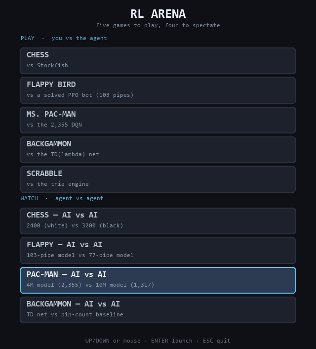

# RL for video games (Atari) — local setup

Six games, six agents, one arena you can play in: chess, Flappy Bird, Ms. Pac-Man, backgammon,
Doom and Scrabble. Everything here was trained and measured on this machine.



Built by **Hermes Agent** (Nous Research) running the **`deepseek-v4.1-flash:cloud`** model,
working under continuous human review and supervision — see [CREDITS.md](CREDITS.md) for exactly
what that means, what the agent decided alone, and what the operator decided.

| game | play | watch |
|---|---|---|
| chess | you vs Stockfish | two engines |
| Flappy Bird | you vs a 103-pipe PPO bot | two bots racing |
| Ms. Pac-Man | you vs the 3,230 Rainbow C51 (2,355 DQN with `--agent dqn`) | 10M model vs 4M model |
| backgammon | you vs a TD(λ) net | net vs pip baseline |
| Doom | — | PPO agent streaming from WSL |
| Scrabble | you vs the trie engine | bot vs bot |

Launch: double-click `RL Arena.exe` (a 9.6 MB launcher, built with PyInstaller) or run
`.venv/Scripts/python.exe arena.py`.

Deep-RL agent stack that learns to play Atari 2600 games from pixels.
Built here, runs here: CUDA on the RTX 5060, 216 games available.

## What's installed

- Python 3.12 venv: `.venv/`
- PyTorch 2.11.0+cu128 (Blackwell sm_120 OK), torchvision
- stable-baselines3 2.3.2 (DQN / PPO / A2C), gymnasium 0.29.1
- ale-py 0.10.1 — Arcade Learning Environment with bundled ROMs (216 games, no AutoROM needed)
- opencv (frame preprocessing), imageio-ffmpeg (mp4 recording), tensorboard

## Files

- `train.py` — generic trainer. Atari preprocessing = noop-reset, 4x frame skip,
  max-pool, grayscale 84x84, 4-frame stack, reward clipping, episodic life.
- `play.py` — loads a checkpoint, plays episodes, records mp4 (or `--live` window).
- `replay_gpu.py` — replay buffer kept in GPU VRAM (uint8 frames on the 5060) instead of
  ~5.6 GB of system RAM; samples without a host→device copy.
- `compare.py` — side-by-side eval curves for several runs.
- `models/<game>/<algo>/` — `best.zip`, `final.zip`, checkpoints, `train_meta.json`
- `logs/<game>/<algo>/` — tensorboard runs + `evaluations.npz`
- `videos/<game>/` — recorded gameplay

## Usage

```bash
cd C:/Users/melet/AI/rl-games

# train — DQN with the replay buffer in VRAM on the RTX 5060
.venv/Scripts/python.exe train.py --game breakout --steps 1000000 \
    --n-envs 16 --batch-size 32 --gradient-steps 4 --buffer-size 120000 --gpu-buffer

# PPO instead
.venv/Scripts/python.exe train.py --game space_invaders --algo ppo --steps 5000000 \
    --n-envs 16 --batch-size 512

# continue an existing run
.venv/Scripts/python.exe train.py --game pong --resume models/pong/dqn/final.zip --steps 500000

# watch / record
.venv/Scripts/python.exe play.py --model models/pong/dqn/best.zip --episodes 3
.venv/Scripts/python.exe play.py --model models/pong/dqn/best.zip --live

# compare two runs' eval curves
.venv/Scripts/python.exe compare.py pong dqn_cmp ppo_cmp

# curves
.venv/Scripts/python.exe -m tensorboard.main --logdir logs
```

Game names: any ALE title, lowercase with underscores — `pong`, `breakout`,
`space_invaders`, `mspacman`, `qbert`, `skiing`, `pitfall`, `enduro`, `freeway`, ...

## Results (this machine)

Pong, DQN, 900k steps, 15 min total: eval reward -21 (random) -> +18.0 at 850k.
Best model scores 19 / 16 / 21 (21 = perfect) over 3 recorded episodes.
Videos: `videos/pong/*.mp4`.

PPO vs DQN at 300k steps, same env stack:
```
    steps      dqn_cmp      ppo_cmp
  299,904       -17.33       -21.00
```
DQN learns from pixels far earlier; PPO needs millions of frames but steps ~3x faster.

## GPU-resident simulation + training (MJX / JAX)

ViZDoom, ALE and every classic emulator step on the **CPU** — one core per env instance,
and they cannot be moved to the GPU. For GPU-native RL (thousands of 3D physics envs in
VRAM, sim + gradients never leaving the device) this repo uses MuJoCo-MJX via JAX.

Runs inside WSL2 (JAX has no official Windows GPU wheels):

```bash
# one-time: Ubuntu rootfs imported as distro "jaxgpu" on D:, venv at /root/gpurl
wsl -d jaxgpu -u root -- /root/gpurl/bin/python \
  /mnt/c/Users/melet/AI/rl-games/mjx_ppo.py --env halfcheetah --envs 4096 \
  --steps 80000000 --unroll 32 --minibatch-size 2048 --gamma 0.97 --ent-coef 0.005
```

- `mjx_ppo.py` — self-contained PPO (scan-based rollout, GAE, minibatched clipped
  objective, KL safety valve, running obs normalisation). No CPU env loop; brax only
  supplies the MJX env definitions (`ant`, `halfcheetah`, `humanoid`, `hopper`, ...).
- `brax_ppo.py` — env-only throughput benchmarks (`--bench`, `--bench-sweep`).

Measured on the RTX 5060 Laptop (8 GB):

| what | result |
|---|---|
| MJX ant, env-only (`--bench-sweep`) | 392,606 env steps/s @ 16,384 envs |
| MJX ant, PPO included | ~380,000 env steps/s @ 4,096 envs |
| MJX halfcheetah, PPO included | ~95,000 env steps/s @ 4,096 envs |
| VRAM while training | 4.4–4.9 GB of 7.9 GB, GPU util 90–97% |

Notes:
- Brax 0.14.2's own training agents are stale (`jax.device_put_replicated` removed in
  JAX 0.12), which is why `mjx_ppo.py` implements PPO directly instead of using
  `brax.training`.
- Isaac Lab / Isaac Gym need Ubuntu + `isaacsim` (~20 GB) and more VRAM than 8 GB for
  useful scene counts; MJX gives the same GPU-resident property at a fraction of the cost.

## Pac-Man (Ms. Pac-Man) with PPO

```bash
# train (fast flags: 16 envs == 16 cores, env checker off, torch threads 1)
.venv/Scripts/python.exe train.py --game mspacman --algo ppo --steps 10000000 \
    --n-envs 16 --batch-size 512 --no-eval

# record 3 seed-varied playthroughs, then build a watch page
.venv/Scripts/python.exe play.py --model models/mspacman/ppo/best_model.zip --episodes 3
.venv/Scripts/python.exe make_demo.py --game mspacman --algo ppo     # -> mspacman_demo.html
```

`mspacman_demo.html` shows the recordings + the eval curve; open it in a browser.
Live window: `play.py --model ... --live`.

Throughput notes for Atari PPO on this box: ~1,250-2,500 env steps/s, CPU-bound
(16 emulator processes), GPU 10-40%. Disabling gymnasium's per-step env checker and
`max_episode_steps`, and setting `--torch-threads 1`, bought ~1.7x. More than 16 envs
oversubscribes the cores and is slower. PPO on Ms. Pac-Man needs ~10M+ steps for a
strong score; at ~2M steps it sits near 210.

## Play it as a game (pygame)

`pacman_arcade.py` runs any trained checkpoint in a pygame window: the ALE frame scaled 3x,
a HUD (mode, score, best, model, fps), and agent/human hot-swap.

```bash
.venv/Scripts/python.exe pacman_arcade.py --model models/mspacman/dqn_envpool/final_1000000.zip
.venv/Scripts/python.exe pacman_arcade.py --model models/mspacman/ppo_envpool/final.zip --scale 4
```

Keys: TAB agent↔human · arrows steer in human mode · SPACE pause · R new episode · S screenshot · ESC quit.
The policy sees exactly its training input (84x84 gray, 4 stacked frames, 4-frame repeat) while the
window shows the full-colour 160x210 frame.

Verification without a display: `--headless 260 --shot videos/arcade_shot.png` renders the window
offscreen and dumps a PNG.

## Six games in one place — `arena.py`

```bash
.venv/Scripts/python.exe arena.py
```

One menu, Enter to play. Each game runs in its own process, so a crash never takes the menu down.

| game | agent | how it was trained | measured |
|---|---|---|---|
| Chess | Stockfish via UCI | search, not RL (`chess_agent.py`) | depth 23 in 0.5 s; `--elo` dial 1320→3400 |
| Flappy Bird | PPO, 6-float state obs | `train_flappy_state.py`, 4M steps, CPU | 102.8 pipes mean, max 188 |
| Ms. Pac-Man | Double DQN, 1.69M params | `dqn_pacman.py` (EnvPool), 4M steps | 2,355 mean over 6 full games |
| Ms. Pac-Man | C51 Rainbow-lite, 3.55M params | `rainbow_pacman_3.py` (EnvPool), 10M steps | **3,530** mean over 12 games (+50% over the DQN) |
| Backgammon | TD(λ) self-play value net | `backgammon_agent.py --train`, 25k games | 96.0% vs pip-count player (200 g), 99.2% vs random (120 g) |
| Doom | PPO on ViZDoom, 4 actions | `doom_train.py` under WSL+xvfb, 1.2M steps | eval 12.2 at the 800k checkpoint (final 8.2) |
| Scrabble | trie engine + leave valuation | `scrabble_agent.py`, no learning | ~520 points per side in self-play |

Playable builds: `chess_ui.py`, `flappy_duel.py`, `pacman_duel.py`, `backgammon_ui.py`,
and `scrabble_agent.py --play` (needs a console for typed input).

Spectator builds (`WATCH` in the arena): `chess_ai.py`, `flappy_duel.py --both-bots`,
`pacman_ai.py`, `backgammon_ai.py`.

Chess piece art comes from `pieces-svg.zip` (Uray M. János, CC BY-SA) unpacked to `pieces_svg/`.
pygame cannot read SVG, and cairosvg needs libcairo which Windows does not ship, so the set is
rasterised once inside WSL:

```bash
# in the jaxgpu distro, where libcairo2 is available
apt-get install -y libcairo2 && pip install cairosvg
python - <<'PY'
import cairosvg, pathlib
src, out = pathlib.Path('pieces_svg'), pathlib.Path('pieces_png'); out.mkdir(exist_ok=True)
for base in ('king','queen','rook','bishop','knight','pawn'):
    for c in ('w','b'):
        for px in (78,156,234):
            cairosvg.svg2png(url=str(src/f'{base}-{c}.svg'), write_to=str(out/f'{base}-{c}-{px}.png'),
                             output_width=px, output_height=px)
PY
```

`chess_ui.load_piece_images(SQ)` picks the nearest resolution and smoothscales; if `pieces_png/`
is missing it falls back to letter glyphs, so the game still works.

Why these are four different kinds of agent rather than one network: chess and backgammon are
symbolic and turn-based, Scrabble is imperfect information over words, and the three arcade
games are pixel control. A single network covering all six is Gato-class work; the honest
architecture is one interface with a backend per game family.

### Game-specific notes

- **Flappy**: pixel PPO plateaus at "survive without passing pipes" — at 84×84 the gap is ~21 px
  and the bird ~3 px. The 6-float state view (`bird y`, `velocity`, two gap offsets) solves it in
  ~2 minutes of CPU training. Same physics and rewards; only the observation differs.
- **Backgammon**: full rules, including bar entry, hitting, bear-off and the must-play-maximum-dice
  rule. `all_home()` must ignore *opponent* checkers on the outer board — getting that backwards
  silently makes bearing off impossible and every game runs to the ply cap.
- **Doom**: the ViZDoom Windows wheel segfaults at `g.init()` on this machine regardless of
  sound/window settings. It runs in WSL under `xvfb-run` instead, which is also why it's slow
  (software rendering, ~80 steps/s with one env).
- **Scrabble**: `Move.placed` must record which tiles were *newly* placed — a move's word includes
  tiles already on the board, so spending `m.word` against the rack raises `ValueError` as soon as
  a word crosses existing letters.

## Fixes and upgrades (round 2)

Bugs found and fixed:

| where | bug | effect |
|---|---|---|
| `backgammon_ui.py` | `point_at()` only mapped the 24 triangles | the off tray was unclickable — **a human game could never end**, because bearing off is a click |
| `backgammon_ui.py` | the bar was not clickable either | with checkers on the bar the human had no legal move and no way to enter |
| `arena.py` | a closing game handed its click to the menu | clicking to close a game re-launched it (fixed with an event drain + 600 ms guard, button-1 only, one entry per click) |
| `scrabble_agent.py` | `score_move` scored twice and threw the first pass away | correctness was fine, 2x wasted work per candidate move; rewritten as one pass |
| `scrabble_agent.py` | human games had no end condition | `--play` ran forever; now ends after four consecutive passes |
| `doom_play.py` | `kills` declared, never counted | episode summaries reported no kills |
| `doom_train.py` | no `--resume` | a plateaued run could not be continued; added |
| `arena.py` | Doom entry hardcoded one run path | a retrain would not be picked up; now resolves the newest `best_model.zip` |

Upgrade — backgammon 2-ply expectimax:

`choose_2ply()` ranks legal moves with the value net, keeps the best 6, then plays out all 21
distinct dice rolls and lets the opponent take their best reply. Head to head, same net on both
sides, alternating colours:

```
2-ply 95W · 1-ply 25W · 0D over 120 games → 79.2% for 2-ply
```

(First 20 games read 15W-5W; the 120-game result is the number to trust.)

So the search depth is worth real strength, and `backgammon_ui.py --search 2ply` (the default)
plays better than the net it uses. `--search 1ply` is the fast mode.

## Rainbow-lite: un-squashing the ghost reward (Ms. Pac-Man)

Ms. Pac-Man pays 200/400/800/1600 for successive ghosts in one energiser window, against 10 per
dot — a 160:1 ghost:dot ratio. A square-root reward squash, `sign(r)(sqrt(|r|+1) - 1)`, compresses
that 1600-point chain to 39.0 and a 10-point dot to 2.32, cutting the ratio to **16.8:1** and giving
the agent little reason to hunt ghost chains at all. Linear scaling preserves the ratio exactly:

| transform | 4th ghost (1600) | dot (10) | ratio |
|---|---|---|---|
| squash `sign(r)(sqrt(|r|+1)-1)` | 39.0 | 2.32 | 16.8 : 1 |
| scale `r * 0.01` | 16.0 | 0.10 | 160 : 1 |

Same 3.55M-param C51 network throughout, six to twelve full-game episodes per evaluation:

| run | steps | mean |
|---|---|---|
| Double DQN baseline | 4M | 2,355 |
| QR-DQN (51 quantiles) | 4M / 12M | 872 / 832 |
| C51 + squash | 4M | 1,500 → 2,040 |
| C51 + linear scale | 4M | 2,380 |
| **C51 + linear scale, batch 128 / 4 grad steps** | **10M** | **3,530** (best, at 9.5M; 3,280 final) |

The win is attributable to reward magnitude and update density rather than the distributional head:
QR-DQN lost outright, and C51 only passed DQN once the squash was removed. Best-model selection is
strict-improvement-only over 12 evaluation episodes, so the reported number is a checkpoint, not a
lucky sample.

Reproduce:

```bash
python rainbow_pacman_3.py --envs 32 --steps 10000000 --trunk nature --width 64 --atoms 51 \
  --batch-size 128 --gradient-steps 4 --reward-transform scale --reward-scale 0.01 \
  --vmin -1 --vmax 25 --buffer 60000 --eps-steps 400000 --n-step 3 \
  --eval-every 500000 --eval-episodes 12 --out models/rainbow_scale_10m
```

### The support width matters more than the head

Widening `--vmax` to "make room for big ghost chains" destroys resolution. A real episode return
under scale 0.01 is ~4.6 (= 460 game points), so with 51 atoms spread over `[-1, 150]` the bin is
302 raw points wide and returns of 20, 100 and 300 points all land on **atom 0-1** — the head cannot
rank actions at all, and training flattens at 60-90:

| support | bin | 20 pts | 100 pts | 300 pts | measured |
|---|---|---|---|---|---|
| `[-1, 25]`, 51 atoms | 52 pts | atom 2 | atom 4 | atom 8 | **3,530** |
| `[-1, 150]`, 51 atoms | 302 pts | atom 0 | atom 1 | atom 1 | 60-90, flat |
| `[-1, 40]`, 101 atoms | 41 pts | atom 3 | atom 5 | atom 10 | not competitive by 6.5M |

### Replay capacity is a RAM problem, not a VRAM one

The model needs ~850 MiB of VRAM at batch 128 — the 8 GB card was never the constraint. Replay is a
host numpy array, and storing `obs` plus `next_obs` as two 4-frame stacks costs 26.3 GB at 500k
transitions, which does not fit in a 28 GB WSL VM and dies at CUDA init. Consecutive stacks overlap
3 of 4 frames, so `rainbow_pacman_3.py` stores one 5-frame window per transition instead
(`obs = w[:4]`, `next_obs = w[1:]`), verified bit-identical against the naive layout:

| capacity | two 4-frame stacks | one 5-frame window |
|---|---|---|
| 60,000 | 3.2 GB | 2.0 GB |
| 200,000 | 10.5 GB | 6.6 GB |
| 500,000 | 26.3 GB | **16.4 GB** |

`--naive-frames` restores the old layout for comparison.

### Shipping it in the arena (`pacman_duel.py`)

Wiring the checkpoint into the playable duel first looked impossible: a Windows-side viewer scored
it 280 against EnvPool's 3,530. That was a bug in the viewer, not a preprocessing mismatch. Dumping
`(210x160 RGB, 84x84 obs)` pairs from two lockstep EnvPool instances and comparing candidate
pipelines pixel by pixel isolated the real difference:

| pipeline | exact pixels | mean abs diff |
|---|---|---|
| grayscale → resize `INTER_AREA` (**EnvPool**) | 99.6% | 0.05 |
| resize `INTER_AREA` → grayscale (gymnasium) | 92.0% | 0.13 |
| resize `INTER_LINEAR` → grayscale | 72.5% | 5.14 |
| PIL bilinear → `L` | 53.3% | 2.88 |

`pacman_duel.py` now does what EnvPool does — grayscale first, then `INTER_AREA`, with the last two
of the four skipped frames max-pooled — and measures honestly in the same window it ships:

| agent | arena harness | training reference |
|---|---|---|
| Rainbow C51 (`--agent rainbow`, default) | **3,230** | 3,530 on EnvPool |
| DQN (`--agent dqn`) | 2,210 | 2,355 on EnvPool |

Both reproduce their training scores within ~8%, so the gap was never the observation pipeline.
`diag/dump_envpool_obs.py` and `diag/win_rainbow_eval.py` are kept so the comparison is repeatable.

### What did not work

- **Impala trunk** (`--trunk impala`, 4.26M params): 744 steps/s versus 2,851 for the nature CNN —
  3.8x the wall clock for 1.2x the parameters, and no evidence it pays for itself.
- **Wider nature trunk** (`--width 112`, 5.99M params): flat at 210-320 through 6M steps while the
  3.55M trunk was at 1,910+, against a 60k-transition buffer. Capacity without data to constrain it
  memorises instead of generalising.
- **NoisyLinear** (`--noisy`): first run scored 210, but that number is void — the factorised noise
  used `sign(x)|x|` instead of `sign(x)sqrt(|x|)`, inflating every weight's noise to ~N(0,1)
  regardless of fan-in. Fixed, untested since.
- **MCTS / expectimax on top of a fixed DQN**: 680 → 130 (depth 1) → 180 (depth 2), an 87-91%
  regression. Uncalibrated Q-values maximised over a shallow tree pick overestimated actions.

## DQN update-ratio finding (Ms. Pac-Man)

Same 1.69M-param network, unclipped rewards, 6 full-game episodes each:

| setup | updates per env step | mean score |
|---|---|---|
| 4M steps, 32 envs | 1 per 64 | **2,355** |
| 8M more steps at half the LR, same ratio | 1 per 64 | 1,662 (best of that run) |
| 20M steps, 32 envs (`gradient_steps 1`) | 1 per 128 | 1,350 |
| 30M steps, 256 envs, RTX 5090 pod | 1 per 512 | 1,042 |

The 8M continuation was the fair test of "is more steps better at the *right* ratio": checkpoints
evaluated every 1M steps gave 1,498 / **1,662** / 733 / 1,060 / 1,598 / 1,398 / 1,453 / 1,150 —
every single one below the 4M model. So 4M steps at 1 update per 64 frames is the optimum for
this network and buffer, and further gains have to come from architecture (n-step returns,
prioritised replay), not from more training anywhere on this curve.

7.5x the frames bought half the score. Scaling `n_envs` without scaling `gradient_steps`
starves the learner — the pod sat at 50% GPU utilisation the whole run, which was the tell.

Measured cost of capacity on the 5060 (batch 32): 1.7M net = 1.9 ms/update, 5.5M = 2.1 ms,
21M = 7.2 ms. A 30M trunk therefore costs ~4x per update, so 60M steps becomes ~15 h on this
laptop — and the evidence above says capacity is not what limits score.

## Notes / gotchas (Atari / ViZDoom)

- SB3's `make_atari_env` no longer frame-stacks; `train.py` adds `VecFrameStack(4)` +
  `VecTransposeImage` explicitly, and passes `frameskip=1` so the total skip is 4, not 16.
- Eval uses `terminal_on_life_loss=True` during training (standard), full episodes when playing.
- DQN Pong needs roughly 1M env steps (~800k-1.5M) to go from -21 to positive score.
  Breakout shows reward improvement much earlier (~200k).
